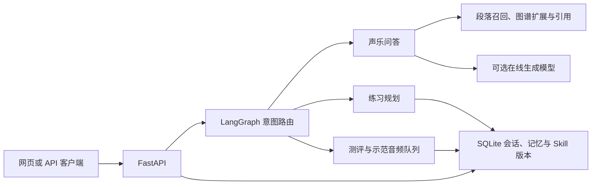

# DeepVocal 声乐导师

DeepVocal 是一个本地单用户声乐练习台。练习者可以查阅带出处的声乐建议、测评清唱、生成练习计划，以及获取跟唱参考音。浏览器工作台和 API 都由 FastAPI 提供。

## 功能

| 功能 | 当前实现 |
|---|---|
| 声乐问答 | TF–IDF、可选 Milvus 语义召回和两跳图谱扩展。在线回答展示实际引用的段落及出处 |
| 录音测评 | 对比清唱与内置参考旋律，提供逐音音高偏差、音高波动和可检测的起音偏差 |
| 练习规划 | 根据测评、练习目标和进度安排热身、专项练习与复测。支持 Skill 候选评审和版本化加载 |
| 示范音频 | 本地合成参考旋律。接入独立服务后可根据歌词生成歌声 |
| 历史对话 | 在侧栏打开、翻页和删除会话。SQLite 保存消息及跨会话的练习记忆 |



## 快速启动

以下命令适用 Windows PowerShell，已使用 Python 3.11 验证。在项目根目录执行。基础配置带有自编示例，直接提供本地 TF–IDF 检索和证据摘录。

```powershell
python -m venv .venv
.\.venv\Scripts\python.exe -m pip install -r requirements.txt
.\.venv\Scripts\python.exe -m uvicorn deepvocal.main:app --host 127.0.0.1 --port 8000
```

访问 [练习台](http://127.0.0.1:8000/) 或 [Swagger 接口文档](http://127.0.0.1:8000/docs)。在「声乐问答」中输入「什么是换声区？」即可体验。上传文件、任务、会话与记忆默认保存在本目录的 `data/`。项目以单进程运行，以便恢复队列中的未完成任务。所有会话共享该安装实例的长期记忆。

## 输入模型 API

在网页右上角打开「模型设置」，选择阿里云百炼、DeepSeek、OpenAI 或自定义兼容服务，填写模型 ID 和 API Key。可以先点「测试连接」，再点「保存设置」。Windows 后端会用当前账户的 DPAPI 加密 API Key 后保存在本机数据库。重新打开界面时只显示「Key 已保存」，密码框留空即可复用已保存的 Key。填入新 Key 并保存可替换原 Key。选择「本地 / 服务端预设」并保存会清除已保存的模型配置。其他平台的 API Key 可以通过服务端环境变量提供。模型连接测试会发起一次实际模型请求。自定义模式需要管理员设置 `DEEPVOCAL_CUSTOM_API_BASE`，填写兼容服务的根地址，如 `http://127.0.0.1:11434/v1`。

阿里云百炼的 API 参数为 `provider: "dashscope"`。网页预填 `qwen-plus`，默认使用北京地域的 DashScope 兼容端点。其他地域或业务空间专属域名可以在服务端设置 `DEEPVOCAL_DASHSCOPE_API_BASE`，以 `/compatible-mode/v1` 结尾。参见[百炼官方 Base URL 说明](https://help.aliyun.com/zh/model-studio/base-url)。

百炼请求默认直连。需要使用系统代理时，在启动前设置 `DEEPVOCAL_DASHSCOPE_USE_PROXY=1`。

程序调用使用 `X-Model-API-Key` 请求头。以下 PowerShell 示例从当前环境读 Key。

```powershell
$DeepVocalHeaders = @{'X-Model-API-Key' = $env:MY_MODEL_API_KEY}
$DeepVocalModel = @{provider='deepseek'; model=$env:MY_MODEL_ID} | ConvertTo-Json
Invoke-RestMethod http://127.0.0.1:8000/api/model/test -Method Post `
  -Headers $DeepVocalHeaders -ContentType 'application/json' -Body $DeepVocalModel
```

对话可使用相同的 Header，并在 JSON 中附带 `provider` 和 `model`。需要服务端预设时，可在启动前设置 `DEEPVOCAL_API_PROVIDER`、`DEEPVOCAL_API_KEY`、`DEEPVOCAL_CHAT_MODEL`。如设置 `DEEPVOCAL_ACCESS_TOKEN`，所有 `/api/` 请求需要提供 `X-DeepVocal-Token`。网页可在模型 API 区填写访问令牌。建议保留回环地址绑定以供本机使用。

## 接口

| 方法与路径 | 输入与用途 |
|---|---|
| `POST /api/model/test` | `provider`、`model`、`X-Model-API-Key` |
| `GET /api/model/settings` | 读取服务商、模型 ID 和 Key 保存状态 |
| `PUT /api/model/settings` | 保存服务商、模型 ID 和经 Windows 账户加密的 Key |
| `POST /api/chat` | 文本、会话和任务参数。返回答案、证据、计划或任务 ID |
| `GET /api/sessions` | 按最近活动列出已保存的会话，支持 `limit` 和 `offset` |
| `GET /api/sessions/{id}/turns` | 读取会话消息和关联任务结果，使用 `next_before` 加载更早的消息 |
| `DELETE /api/sessions/{id}` | 删除整个历史会话及从该会话保存的问答记忆，成功返回 204 |
| `GET /api/melodies` | 内置参考旋律及 MIDI 音高 |
| `GET /api/melodies/{id}/guide.wav` | 获取参考音，支持 `bpm`、`transpose` |
| `POST /api/audio` | 上传 `multipart/form-data` 中的 `file`，返回录音 ID |
| `GET /api/jobs/{id}` | 查询任务状态及结果 |
| `GET /api/audio/{id}` | 下载录音或生成结果 |
| `GET /api/memory` | 查看长期记忆 |
| `POST /api/memory/progress` | 保存 `melody_id`、`completed_days` 和可选的 `note` |
| `GET /api/skills` | 查看注册版本和状态 |
| `POST /api/skills/candidates` | 传入 `focus`，从至少两条同主题规划轨迹产生候选 |
| `GET /api/skills/{name}/{version}` | 查看某个版本的指令与关联轨迹 |
| `POST /api/skills/{name}/{version}/review` | 传入 `approve` 布尔值，发布或拒绝候选 |

本地问答可直接提交 JSON。

```json
{"query":"什么是换声区？","intent":"qa","retrieval":"graph"}
```

在 PowerShell 中试用问答接口。

```powershell
$question = @{query = '什么是换声区？'; intent = 'qa'; retrieval = 'graph'} | ConvertTo-Json
Invoke-RestMethod http://127.0.0.1:8000/api/chat -Method Post `
  -ContentType 'application/json; charset=utf-8' -Body ([Text.Encoding]::UTF8.GetBytes($question))
```

测评先上传 WAV，再把返回的录音 ID 填入以下请求。录音需为 16 位 PCM WAV，8–48 kHz，最长 60 秒，上传上限 12 MiB。使用同一参考旋律、速度和移调参数录制。如果开头录进了预备拍，填写第一个参考音在录音中的秒数。分析适用于单一声源，按已知节拍的位置比较音高。起音指标仅在检测到清晰过渡时出现。

```json
{
  "query":"测评并安排练习",
  "audio_id":"替换为上传返回的ID",
  "melody_id":"warmup",
  "bpm":90,
  "transpose":0,
  "offset_seconds":0,
  "days":3,
  "minutes":15
}
```

用返回的 `job.id` 查询任务。响应中 `result.plan` 是后续计划。新会话仍可以用长期记忆，也可把已完成任务的 ID 作为 `assessment_job_id` 提交到 `practice_plan`。练习时长和目标也会进入画像。

## 教材导入和图谱 RAG

### 开放教材试点

`examples/voice_class/` 收录 Rollo Fisher 的《Voice Class》第 1.2、1.3 和 1.4 节中的 14 个教学段落和 8 条经人工核对的图谱关系。项目对原文做了节选与空白整理，添加了中文小节名和实体标签。每条引用保留作者、章节、授权、PDF 页序和原文地址。示例教材及其节选标注采用 CC BY 4.0。[LibreTexts 教材](https://human.libretexts.org/Bookshelves/Music/Music_Performance/Voice_Class_%28Fisher%29) · [CC BY 4.0](https://creativecommons.org/licenses/by/4.0/)

要使用这批语料，将示例复制到 `data/knowledge`，再启动服务。已有同名语料时保留本地版本。

```powershell
New-Item -ItemType Directory -Path .\data\knowledge -Force | Out-Null
Get-ChildItem -Path .\examples\voice_class -Filter '*.json' | ForEach-Object {
  $target = Join-Path .\data\knowledge $_.Name
  if (-not (Test-Path -LiteralPath $target)) {
    Copy-Item -LiteralPath $_.FullName -Destination $target
  }
}
```

三节的原始 PDF 可从 LibreTexts 下载。[1.2 姿势与呼吸](https://human.libretexts.org/@api/deki/pages/72769/pdf/1.2%253A%2bBasics%2bof%2bSinging%2b1-%2bPosture%2band%2bBreathing.pdf) · [1.3 热身与练习](https://human.libretexts.org/@api/deki/pages/72770/pdf/1.3%253A%2bBasics%2bof%2bSinging%2b2-%2bWarmups%2band%2bPractice%2bTechnique.pdf) · [1.4 学唱新歌](https://human.libretexts.org/@api/deki/pages/72771/pdf/1.4%253A%2bBasics%2bof%2bSinging%2b3-%2bHow%2bto%2bLearn%2ba%2bSong.pdf)

补充教材可选 Amy Rosine 的《Vocal Techniques for the Instrumentalist》（呼吸、发声和共鸣，CC BY-NC 4.0）及 Robert Hutchinson 的《Music Theory for the 21st-Century Classroom》（音高、节奏和音程，GNU FDL 1.2 或更新版本）。[Kansas State University 官方 PDF](https://www.fulcrum.org/ebooks/v118rj19z/download?locale=en) · [University of Puget Sound 官方整本 PDF](https://musictheory.pugetsound.edu/hw/MusicTheory-Sep-2025.pdf)

### 启动和导入其他教材

```powershell
.\.venv\Scripts\python.exe -m pip install -r requirements-rag.txt
.\start-rag.ps1
```

启动脚本对可发给外部服务的资料使用百炼 `qwen3.7-text-embedding-flash`，维度 1024，向量写入 Milvus Lite。脚本会复用项目已保存的百炼 Key，也可设置 `DEEPVOCAL_EMBEDDING_API_KEY`。语义模型配置后可通过 `GET /api/health` 检查 `embedding_model`、`knowledge_chunks` 和 `imported_documents`。

在自编语料的 10 条示例题上，Flash 和 `text-embedding-v4` 的图谱检索 Recall@3 均为 1.00，nDCG@3 分别为 0.992 和 1.000。按北京地域同步接口的公开单价，Flash 为 0.000125 元/千输入 Token，v4 为 0.0005 元/千输入 Token。当前选用 Flash。教材入库后，用人工标注的教材问答重新评估排序和引文页码。[百炼向量模型规格与定价](https://help.aliyun.com/zh/model-studio/text-embedding-synchronous-api)

仓库内置自编示例知识库。西南大学出版集团的数字教材目录收录了胡钟刚、张友刚的《声乐实用基础教程》，ISBN `978-7-5697-1577-4`。取得可用于本项目的第 5 版 PDF 后，运行以下命令并重启服务。扫描 PDF 先做 OCR 并核对页码。[出版社数字教材目录](https://xdcbs.swu.edu.cn/tszx/szjc.htm)

```powershell
.\.venv\Scripts\python.exe -m deepvocal.ingest '.\声乐实用基础教程-第5版.pdf' `
  --id shengyue-v5 --title '声乐实用基础教程' --edition '第5版' `
  --source-url 'https://xdcbs.swu.edu.cn/tszx/szjc.htm'
```

导入器支持带文字层的 PDF 和 UTF-8 的 TXT、Markdown。`--pages` 可按 PDF 页序选取指定页面，例如 `--pages '12-35,39'`。每页独立切分，段落约 500 字，相邻段落重叠 60 字，引用保留书名、版次、PDF 页序和有差异的 PDF 页标。可用 `--section` 给选入的页添加章名。导入结果写入 `data/knowledge`，随服务启动读入。该目录使用项目既有的数据目录配置。

导入默认仅在本机使用。只要存在本地资料，启动脚本就使用 `BAAI/bge-small-zh-v1.5`（512 维）和本机 Milvus Lite 为整个知识库检索。模型权重在首次需要时下载并缓存在 `data/embedding-models`。可用 `-Local` 提前加载模型。包含本地证据的问答直接在本机展示带引用的段落，后续百炼问答也会从模型上下文排除这些历史回答。只有你的资料允许发送给外部模型时，才用 `--allow-cloud` 导入。

LangGraph 的问答节点先在 Milvus 中按余弦相似度召回 8 个段落，再合并本地 TF–IDF 候选。图谱从问题中命中的实体或前两个候选的实体出发，沿已有关系扩展最多两跳和 30 条边。重排结合向量分数、词项匹配、实体命中和图谱距离，返回最多 3 个带页码的证据。常见实体会按字面匹配标注；新增关系由人工审核后写入导入 JSON 的 `relations`，每条填写 `head`、`relation`、`tail`、`evidence_id`。`evidence_id` 必须指向语料中现有的段落。

`POST /api/chat` 用 `intent: "qa"` 进入问答。`retrieval` 支持 `vector`（召回基线）、`rerank`（合并 TF–IDF 候选并按实体重排）和 `graph`（扩展实体关系）。在线模型会检查候选能否支持回答，后端校验引用 ID，界面展示实际引用的段落。全部候选缺少直接依据时，在线问答返回证据不足。生成模型不可用时，问答会展示原因和检索摘录。以下命令使用同一组问题和证据标签评估三种模式，评测使用独立的本地向量索引。

```powershell
.\start-rag.ps1 -Evaluate
```

## 歌声合成

`intent: "singing"` 单独传参考旋律时，会生成可跟随的合成参考音。提交歌词进行歌声合成前，启动歌声服务，并设置 `DEEPVOCAL_SINGING_URL` 和可选的 `DEEPVOCAL_SINGING_TOKEN`。该服务需接受 HTTP POST，入参为 `lyrics`、`midi_notes`、`bpm`、`beats_per_note` 和 `voice`，成功时直接返回 16 位 PCM WAV。

仓库附带 `adapters/diffsinger_opencpop.py`，可在独立的 DiffSinger 环境中使用。按 [OpenCpop Cascade 官方说明](https://github.com/MoonInTheRiver/DiffSinger/blob/master/docs/README-SVS-opencpop-cascade.md)准备代码、模型和声码器，确认原仓库示例可推理后，在 **DiffSinger 的 Python 环境**运行以下命令（替换仓库与 checkpoint 目录名称）。

```powershell
python adapters/diffsinger_opencpop.py --repo C:\path\to\DiffSinger --config usr/configs/midi/cascade/opencs/ds60_rel.yaml --exp-name 0303_opencpop_ds58_midi
```

然后启动 DeepVocal 时设置 `DEEPVOCAL_SINGING_URL=http://127.0.0.1:8010/sing`。该适配器每个音符对应一个汉字。八音练习填八个字，五音练习填五个字。本目录没有歌词合成模型权重。

## 评测与测试

```powershell
.\.venv\Scripts\python.exe -m unittest discover -s tests -v
.\.venv\Scripts\python.exe -m deepvocal.evaluate eval/demo.jsonl --expected-count 10
```

示例知识库在 `deepvocal/knowledge.py`。评测脚本计算三组方案的 Recall@3、MRR@3、nDCG@3、耗时及未命中的问题。用人工评审后的 100 条问答运行时，使用相同 JSONL 格式，每行提供 `question`、`relevant_chunk_ids`，可另存 `reference_answer` 供答案评审，并加 `--expected-count 100`。仓库中的 10 条是用于验证评测流程的示例。

## 项目结构

| 路径 | 用途 |
|---|---|
| `deepvocal/main.py`、`deepvocal/workflow.py` | HTTP 接口、任务队列与 LangGraph |
| `deepvocal/knowledge.py`、`deepvocal/retrieval.py` | 图谱、混合检索和向量索引配置 |
| `deepvocal/audio.py` | 录音分析和参考音生成 |
| `deepvocal/static/` | 浏览器练习台 |
| `examples/voice_class/` | 带出处的开放教材示例 |
| `eval/demo.jsonl`、`tests/` | 检索评测集和 API 回归测试 |
