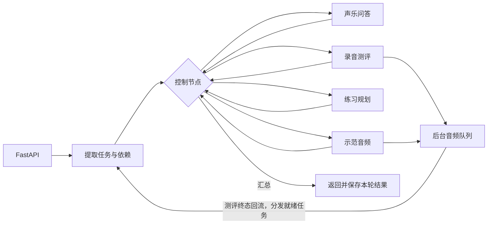

# DeepVocal 声乐导师

DeepVocal 是一个本地单用户声乐练习台。练习者可以查阅带出处的声乐建议、测评清唱、生成练习计划，以及获取跟唱参考音。浏览器工作台和 API 都由 FastAPI 提供。

## 功能

| 功能 | 当前实现 |
|---|---|
| 声乐问答 | 大模型决定是否检索。知识库支持 TF–IDF、可选 Milvus 语义召回和两跳图谱扩展，在线回答展示实际引用的段落及出处 |
| 录音测评 | 测评 Agent 按需查找参考歌曲，由音频模型定位片段并给出音准、节奏和稳定性反馈 |
| 练习规划 | 根据测评、练习目标和进度安排热身、专项练习与复测。支持 Skill 候选评审和版本化加载 |
| 歌曲翻唱 | 按歌名查找参考主唱，用本人录音的音色在本机生成。也可合成练习参考旋律 |
| 历史对话 | 在侧栏打开、翻页和删除会话。SQLite 保存消息及跨会话的练习记忆 |



## 快速启动

以下命令适用 Windows PowerShell，已使用 Python 3.11 验证。在项目根目录执行。基础配置带有自编示例与本地 TF–IDF 索引。使用声乐问答前，在「模型设置」中保存支持工具调用的模型。

```powershell
python -m venv .venv
.\.venv\Scripts\python.exe -m pip install -r requirements.txt
.\.venv\Scripts\python.exe -m uvicorn deepvocal.main:app --host 127.0.0.1 --port 8000
```

访问 [练习台](http://127.0.0.1:8000/) 或 [Swagger 接口文档](http://127.0.0.1:8000/docs)。在「声乐问答」中输入「什么是换声区？」即可体验。上传文件、任务、会话与记忆默认保存在本目录的 `data/`。项目以单进程运行，以便恢复队列中的未完成任务。所有会话共享该安装实例的长期记忆。

## 输入模型 API

在网页右上角打开「模型设置」，选择阿里云百炼、DeepSeek、OpenAI 或自定义兼容服务，填写模型 ID 和 API Key。可以先点「测试连接」，再点「保存设置」。Windows 后端会用当前账户的 DPAPI 加密 API Key 后保存在本机数据库。重新打开界面时只显示「Key 已保存」，密码框留空即可复用已保存的 Key。填入新 Key 并保存可替换原 Key。选择「本地 / 服务端预设」并保存会清除已保存的模型配置。其他平台的 API Key 可以通过服务端环境变量提供。模型连接测试会发起一次实际模型请求。自定义模式需要管理员设置 `DEEPVOCAL_CUSTOM_API_BASE`，填写兼容服务的根地址，如 `http://127.0.0.1:11434/v1`。

阿里云百炼的 API 参数为 `provider: "dashscope"`。网页预填 `qwen-plus`，默认使用北京地域的 DashScope 兼容端点。其他地域或业务空间专属域名可以在服务端设置 `DEEPVOCAL_DASHSCOPE_API_BASE`，以 `/compatible-mode/v1` 结尾。参见[百炼官方 Base URL 说明](https://help.aliyun.com/zh/model-studio/base-url)。

百炼请求默认直连。需要使用系统代理时，在启动前设置 `DEEPVOCAL_DASHSCOPE_USE_PROXY=1`。

程序调用使用 `X-Model-API-Key` 请求头。以下 PowerShell 示例从当前环境读 Key。

```powershell
$DeepVocalHeaders = @{'X-Model-API-Key' = $env:MY_MODEL_API_KEY}
$DeepVocalModel = @{provider='deepseek'; model=$env:MY_MODEL_ID} | ConvertTo-Json
Invoke-RestMethod http://127.0.0.1:8000/api/model/test -Method Post `
  -Headers $DeepVocalHeaders -ContentType 'application/json' -Body $DeepVocalModel
```

对话可使用相同的 Header，并在 JSON 中附带 `provider` 和 `model`。需要服务端预设时，可在启动前设置 `DEEPVOCAL_API_PROVIDER`、`DEEPVOCAL_API_KEY`、`DEEPVOCAL_CHAT_MODEL`。如设置 `DEEPVOCAL_ACCESS_TOKEN`，所有 `/api/` 请求需要提供 `X-DeepVocal-Token`。网页可在模型 API 区填写访问令牌。建议保留回环地址绑定以供本机使用。

## 接口

| 方法与路径 | 输入与用途 |
|---|---|
| `POST /api/model/test` | `provider`、`model`、`X-Model-API-Key` |
| `GET /api/model/settings` | 读取服务商、模型 ID 和 Key 保存状态 |
| `PUT /api/model/settings` | 保存服务商、模型 ID 和经 Windows 账户加密的 Key |
| `POST /api/chat` | 文本、会话和任务参数。返回答案、证据、计划和已提交的后台任务 |
| `POST /api/chat/stream` | 相同输入。以 SSE 返回问答进度、文字片段和完整结果 |
| `GET /api/sessions` | 按最近活动列出已保存的会话，支持 `limit` 和 `offset` |
| `GET /api/sessions/{id}/turns` | 读取会话消息和关联任务结果，使用 `next_before` 加载更早的消息 |
| `DELETE /api/sessions/{id}` | 删除整个历史会话及从该会话保存的问答记忆，成功返回 204 |
| `GET /api/melodies` | 内置参考旋律及 MIDI 音高 |
| `GET /api/melodies/{id}/guide.wav` | 获取参考音，支持 `bpm`、`transpose` |
| `POST /api/audio` | 通过 `multipart/form-data` 的 `file` 上传 WAV 或 M4A，返回录音 ID |
| `POST /api/audio/reference` | 上传参考 WAV 或 M4A，可附带 `song_title`，返回参考音频 ID 和时长 |
| `POST /api/voice-conversions` | 提交基于本人音色的 Seed-VC 翻唱任务 |
| `GET /api/jobs/{id}` | 查询任务状态及结果 |
| `GET /api/audio/{id}` | 下载录音或生成结果 |
| `GET /api/memory` | 查看长期记忆 |
| `GET /api/memory/assessments` | 按 `melody_id`、旋律名称 `query` 或歌曲 `segment_id` 查询测评历史和复测结果 |
| `POST /api/memory/progress` | 保存 `melody_id`、`completed_days` 和可选的 `note` |
| `GET /api/skills` | 查看注册版本和状态 |
| `POST /api/skills/candidates` | 传入 `focus`，从至少两条同主题规划轨迹产生候选 |
| `GET /api/skills/{name}/{version}` | 查看某个版本的指令与关联轨迹 |
| `POST /api/skills/{name}/{version}/review` | 传入 `approve` 布尔值，发布或拒绝候选 |

本地问答可直接提交 JSON。

```json
{"query":"什么是换声区？","intent":"qa","retrieval":"graph","use_saved_model":true}
```

在 PowerShell 中试用问答接口。

```powershell
$question = @{query = '什么是换声区？'; intent = 'qa'; retrieval = 'graph'; use_saved_model = $true} | ConvertTo-Json
Invoke-RestMethod http://127.0.0.1:8000/api/chat -Method Post `
  -ContentType 'application/json; charset=utf-8' -Body ([Text.Encoding]::UTF8.GetBytes($question))
```

测评先上传 WAV 或 M4A，再把返回的录音 ID 提交给 `POST /api/chat`。录音最长 60 秒，上传上限 12 MiB。WAV 需为 16 位 PCM，8–48 kHz。M4A 由服务端解码为 WAV，供试听、索引和测评使用。需要跳过预备拍时，API 客户端可通过 `offset_seconds` 指定录音起点。

录音测评时，在对话框里用自然语言说明曲名和测评要求，例如「我唱的是《晴天》，想看看副歌的音准」。没有上传对比歌声时，测评 Agent 从用户原话提取曲名，再调用 `search_song_reference` 按曲名和相对音程指纹检索完整参考歌曲，交由音频模型定位片段。缺少曲名时会在对话里提示补充，可以用同一份录音重试。

`POST /api/chat` 也接受结构化的 `song_title`。已上传对比歌声可直接进行对齐。参考文件的音高轨迹和指纹存于 SQLite。上传参考时可明确指定歌名，历史文件可以从文件名补索引，支持 `歌曲名-歌手.wav`。同名版本按录音中的音程指纹命中数排序，测评报告中的 `reference.fingerprint_hits` 会显示命中数。

曲库为空、候选不够可靠或多个片段难以区分时，通过 `GET /api/jobs/{id}` 返回 `result.issue: "reference_not_found"`，测评任务状态为 `needs_input`。页面会提示上传对比歌声，后续可以用同一个 `audio_id` 加上新上传的 `reference_audio_id` 重新测评。

练习指定的内置旋律时，请传 `reference_mode: "builtin"`，并按所选速度和移调参数录制。起音指标只在检测到清晰过渡时出现。

```json
{
  "query":"测评并安排练习",
  "audio_id":"替换为上传返回的ID",
  "reference_mode":"builtin",
  "melody_id":"warmup",
  "bpm":90,
  "transpose":0,
  "offset_seconds":0,
  "days":3,
  "minutes":15
}
```

用返回的 `job.id` 查询任务。响应中 `result.plan` 是后续计划。新会话仍可以用长期记忆，也可把已完成任务的 ID 作为 `assessment_job_id` 提交到 `practice_plan`。练习时长和目标也会进入画像。

练习规划可以直接使用本会话的录音测评，或从用户描述的目标开始。天数和时长自动安排，API 仍支持显式传入 `days`、`minutes` 和 `focus`。`plan.evidence` 记录练习依据，`plan.sessions[].exercises[].evidence_ids` 将专项动作连到对应证据，`step` 表示该专项的分解、短句或原句阶段。配置模型后，系统依据测评和已审核的 Skill 编排目标和时间，并校验动作进阶、每日时长和证据覆盖。缺少测评和具体目标时，先安排一次短练习并建立基准。`plan.retest` 保留参考片段、录音条件和逐项标准。`plan.generation` 标明模型生成或规则回退。

规划 Agent 使用 `search_assessments` 查找本轮关联报告或历史测评，`build_practice_plan` 校验模型提交的草案，`finish_practice_plan` 提交验收结果。用户明确要求依据测评、但找不到可用报告时，任务返回 `needs_input`，并请用户补充测评。通用练习可以直接调用制定计划工具。「每天 8 分钟」和「每天最多 8 分钟」分别作为固定时长和上限参与校验，修正草案和规则回退也遵守这些约束。API 的 `planning_agent` 记录工具动作及状态，与录音测评串联时可在测评任务的 `result` 中读取。

### 用整首歌曲测评演唱片段

在「录音测评」上传自己的演唱录音。如果手边有参考，可以一并附上「对比歌声（可选）」。参考音频可以是整首歌或对应片段，支持 16 位 PCM WAV（8–48 kHz）或 M4A，最长 8 分钟、最大 96 MiB。建议使用清晰的单人主唱或独唱参考。歌曲混音中多个声部会影响主旋律提取。

网页会核验上传的对比歌声与演唱是否为同一首歌，并定位对应的片段。确认上传了不同歌曲时，页面提示更换对比歌声，并保留演唱录音。音频太短或证据不足时会提示检查参考与录音。多个相近候选会先显示供试听，选中后会核验片段再测评。能够对齐时，报告提供参考和演唱的对应时间；本地信号模式包含估计整体速度、逐音音高偏差和波动。两边都检测到清晰起音时，还会显示去除整体速度差后的起音偏差。其余音符的起音偏差留空。

API 先调用 `POST /api/audio/reference` 和 `POST /api/audio`，再提交以下请求：

```json
{
  "query": "测评第二遍副歌",
  "intent": "assessment",
  "reference_audio_id": "参考上传返回的ID",
  "audio_id": "演唱上传返回的ID"
}
```

`align_recording` 将用户录音与完整参考歌曲的重叠窗口发送给音频模型，复核返回的时间范围。多个可信候选由用户试听选择，网页自动提交选中片段的范围。已有选定片段的 API 客户端也可传入 `reference_start_seconds` 和 `reference_end_seconds`。服务端按确认的时间从原 WAV 裁出片段，`analyze_recording` 将裁剪结果和演唱交给音频模型，返回 `audio_feedback` 及可试听的 `reference.clip_audio_url`。音频模型给出定性反馈。内置练习旋律与显式 `alignment_mode: "signal"` 提供本地模式的逐音指标。

录音测评由支持工具调用的模型执行 ReAct 循环。主流程为 `search_song_reference` → `align_recording` → `analyze_recording` → `finish_assessment`。已上传参考时直接核验附件。只有没有上传参考且未指定内置旋律时，Agent 才能调用搜歌工具。曲库分支缺少歌名时会提示补充。已有报告使用 `load_assessment_report`。每个测评最多调用调度模型 5 轮，终态必须与工具证据一致。`assessment_agent` 和 `task_statuses` 记录实际工具和任务状态。需要补充输入或执行失败时，依赖本次测评的规划保持阻塞。

歌曲测评默认 `alignment_mode: "llm"`。音频模型默认 `qwen3.8-omni-flash`，可用 `DEEPVOCAL_AUDIO_MODEL` 配置兼容模型。百炼调度模型复用当前 API Key，也可以单独配置 `DEEPVOCAL_AUDIO_MODEL_API_KEY`。歌曲测评会把需要比对的音频发送到该服务。对于能识别歌词的短片段，使用 `qwen-audio-3.1-asr-flash` 的字词时间戳复核边界。

备用对齐使用 `alignment_mode: "dtw"`。安装 `onnxruntime`，将 [RMVPE ONNX 模型](https://huggingface.co/Scicom-intl/rmvpe-onnx)放在 `data/models/rmvpe.onnx`，也可以配置 `DEEPVOCAL_RMVPE_ONNX_PATH`。备用工具 `align_recording_dtw` 返回候选，用户选中片段后再做音频模型测评。

### 测评记忆和复测

每条内置参考旋律有一个稳定的测评主题。SQLite 保存主题名称、锚点及按报告 ID 归档的每次有效测评。服务启动时从已有的成功任务回填历史。练习规划可跨会话取该旋律最新的有效报告。有效音符不足的报告仍可查看，补录后才能据此生成个性化计划。

新报告会查找参考旋律、速度、移调、评分版本和有效音符范围相同的上一次有效录音。如果有可比较的历史，网页测评卡片会显示两次音高偏差中位数和偏差幅度变化。API 在测评结果的 `comparison` 字段返回两份报告 ID 和对应指标。

用 `GET /api/memory/assessments?melody_id=warmup&limit=10` 查主题和最近测评。也可以传 `query` 查名称或别名。开启本地向量模型时，名称和别名未匹配的查询再做一轮语义检索。曲目有歧义时返回 422，指定 `melody_id` 后即可精确查询。

### 任务并行和串行

主图先提取本轮任务和依赖，每类 Agent 本轮最多接收一个任务。控制节点并行分发已就绪的任务，按任务类型收集结果。有依赖的任务等上游完成后再分发。比如问答和录音测评可以同时开始，要求根据本次测评制定练习计划时，规划会等报告生成后执行。测评失败时，依赖它的计划不会执行。

输入框旁可选择「声乐问答」「录音测评」「练习规划」或「歌曲翻唱」。再次点击已选 Agent 可返回默认的「自动分配」。上传 WAV 或 M4A 后，在消息里说明要测评还是用本人音色翻唱。两个后台 worker 可同时处理录音测评与音频生成，网页会在各任务完成后补上对应结果。

API 调用先从 `POST /api/audio` 取得录音 ID，再提交给 `POST /api/chat`。

```json
{
  "query": "什么是换声区？我这次唱得准吗？",
  "intent": "qa_assessment",
  "audio_id": "替换为上传返回的ID"
}
```

带录音的 `intent: "auto"` 请求也可以识别这种组合。响应的 `steps` 列出本轮任务，`task_statuses` 记录提交时的状态。`jobs` 包含本轮所有已提交的后台任务，`job` 保留首个后台任务以兼容已有调用。可逐个调用 `GET /api/jobs/{id}` 查询结果。如果练习计划依赖本次测评，其结果会随测评任务的 `result.plan` 返回。

## 教材导入和图谱 RAG

### 开放教材示例

`examples/voice_class/` 收录 Rollo Fisher 的《Voice Class》第 1.2、1.3 和 1.4 节中的 14 个教学段落和 8 条经人工核对的图谱关系。项目对原文做了节选与空白整理，添加了中文小节名和实体标签。每条引用保留作者、章节、授权、PDF 页序和原文地址。示例教材及其节选标注采用 CC BY 4.0。[LibreTexts 教材](https://human.libretexts.org/Bookshelves/Music/Music_Performance/Voice_Class_%28Fisher%29) · [CC BY 4.0](https://creativecommons.org/licenses/by/4.0/)

`examples/music_theory/` 收录 10 个开放章节改写的 28 个中文段落和 29 条图谱关系，覆盖半音与全音、音程、大调音阶、调号、移调、音符时值、单拍子与复拍子、弱起和 BPM。每个文件标明原章节、作者和授权。节选内容采用中文改写并补充讲解示例，引用可打开相应章节的原文。[Understanding Basic Music Theory，所选章节采用 CC BY 3.0](https://human.libretexts.org/Bookshelves/Music/Music_Theory/Understanding_Basic_Music_Theory_%28Schmidt-Jones%29) · [Open Music Theory，CC BY-SA 4.0](https://viva.pressbooks.pub/openmusictheory/part/fundamentals/)

要使用这些语料，将示例复制到 `data/knowledge`，再启动服务。已有同名语料时保留本地版本。

```powershell
New-Item -ItemType Directory -Path .\data\knowledge -Force | Out-Null
Get-ChildItem -Path .\examples\voice_class, .\examples\music_theory -Filter '*.json' | ForEach-Object {
  $target = Join-Path .\data\knowledge $_.Name
  if (-not (Test-Path -LiteralPath $target)) {
    Copy-Item -LiteralPath $_.FullName -Destination $target
  }
}
```

三节的原始 PDF 可从 LibreTexts 下载。[1.2 姿势与呼吸](https://human.libretexts.org/@api/deki/pages/72769/pdf/1.2%253A%2bBasics%2bof%2bSinging%2b1-%2bPosture%2band%2bBreathing.pdf) · [1.3 热身与练习](https://human.libretexts.org/@api/deki/pages/72770/pdf/1.3%253A%2bBasics%2bof%2bSinging%2b2-%2bWarmups%2band%2bPractice%2bTechnique.pdf) · [1.4 学唱新歌](https://human.libretexts.org/@api/deki/pages/72771/pdf/1.4%253A%2bBasics%2bof%2bSinging%2b3-%2bHow%2bto%2bLearn%2ba%2bSong.pdf)

`examples/import_rosine.py` 可复现 Amy Rosine 的《Vocal Techniques for the Instrumentalist》78 页印刷版的本地导入。正文按章、小节、段落和习题排版切片，证据保留英文原文、PDF 页序和印刷页码，重点段落附中文摘要。喉部图和练声谱保留原图，跨页 IPA 对照保留两页原版裁图。图版说明参与检索，可在引用中展开并切换到原图尺寸。教材采用 CC BY-NC 4.0，另有注明的内容除外。[Kansas State University 教材](https://doi.org/10.4148/npp.40721)

安装 `requirements-pdf.txt`、`pdfplumber`、`Pillow` 和 Poppler 后，在项目目录传入该印刷版 PDF。若 `pdftoppm` 未加入 `PATH`，用 `--pdftoppm` 指定可执行文件。导入后重启服务。

```powershell
python -m examples.import_rosine 'C:\path\to\Vocal-Techniques-for-the-Instrumentalist-1696291832._print.pdf'
```

可参考 Robert Hutchinson 的《Music Theory for the 21st-Century Classroom》补充音高、节奏和音程资料。[University of Puget Sound 官方整本 PDF](https://musictheory.pugetsound.edu/hw/MusicTheory-Sep-2025.pdf)

### 启动和导入其他教材

```powershell
.\.venv\Scripts\python.exe -m pip install -r requirements-rag.txt
.\start-rag.ps1
```

启动脚本对可发给外部服务的资料使用百炼 `qwen3.7-text-embedding-flash`，维度 1024，向量写入 Milvus Lite。脚本会复用项目已保存的百炼 Key，也可设置 `DEEPVOCAL_EMBEDDING_API_KEY`。语义模型配置后可通过 `GET /api/health` 检查 `embedding_model`、`knowledge_chunks` 和 `imported_documents`。

在自编语料的 10 条示例题上，Flash 和 `text-embedding-v4` 的图谱检索 Recall@3 均为 1.00，nDCG@3 分别为 0.992 和 1.000。按北京地域同步接口的公开单价，Flash 为 0.000125 元/千输入 Token，v4 为 0.0005 元/千输入 Token。当前选用 Flash。教材入库后，用人工标注的教材问答重新评估排序和引文页码。[百炼向量模型规格与定价](https://help.aliyun.com/zh/model-studio/text-embedding-synchronous-api)

仓库内置自编示例知识库。西南大学出版集团的数字教材目录收录了胡钟刚、张友刚的《声乐实用基础教程》，ISBN `978-7-5697-1577-4`。取得可用于本项目的第 5 版 PDF 后，运行以下命令并重启服务。扫描 PDF 先做 OCR 并核对页码。[出版社数字教材目录](https://xdcbs.swu.edu.cn/tszx/szjc.htm)

```powershell
.\.venv\Scripts\python.exe -m deepvocal.ingest '.\声乐实用基础教程-第5版.pdf' `
  --id shengyue-v5 --title '声乐实用基础教程' --edition '第5版' `
  --source-url 'https://xdcbs.swu.edu.cn/tszx/szjc.htm'
```

导入器支持带文字层的 PDF 和 UTF-8 的 TXT、Markdown。`--pages` 可按 PDF 页序选取指定页面，例如 `--pages '12-35,39'`。每页独立切分，段落约 500 字，相邻段落重叠 60 字，引用保留书名、版次、PDF 页序和有差异的 PDF 页标。可用 `--section` 给选入的页添加章名。导入结果写入 `data/knowledge`，随服务启动读入。该目录使用项目既有的数据目录配置。

导入默认仅在本机使用。只要存在本地资料，启动脚本就使用 `BAAI/bge-small-zh-v1.5`（512 维）和本机 Milvus Lite 为整个知识库检索。模型权重在首次需要时下载并缓存在 `data/embedding-models`。可用 `-Local` 提前加载模型。混合候选中有直接相关的可外发证据时，在线模型只使用这些证据。已有的本地摘录历史继续从在线模型上下文排除。只有你的资料允许发送给外部模型时，才用 `--allow-cloud` 导入。

LangGraph 的问答节点在 Milvus 中按余弦相似度召回 8 个段落，并合并本地 TF–IDF 候选。图谱用当前问题里识别出的实体作为起点，优先使用具体术语，沿有向边扩展最多两跳和 30 条边。每条边只补入自身的证据段落，重排时加 `0.04 / 跳数` 的分数，最终最多返回 3 个证据段落。

### 重建和审核图谱

`deepvocal/graph_schema.json` 定义规范实体 ID、实体类型、中英文别名、有向关系类型和抽取规则。实体识别使用领域词典和拍号格式规则，报告保留原文位置。关系规则通过 `head` 和 `tail` 标明方向并保存原文证据。新术语可以通过词典或导入文档里的实体标签补充，人工审核的关系写入导入 JSON 的 `relations`，每条填写 `head`、`relation`、`tail` 和 `evidence_id`。

对标注为 `exclusive` 的关系，同一实体在相同 `scope` 下出现有效期重叠且取值不同的断言时，相关边进入冲突报告并退出图谱扩展。`valid_from` 和 `valid_to` 使用日期，区间包含起始日并排除结束日。未填写的一端视为无界，未填写 `scope` 的断言在默认范围中比较。服务启动时会从语料重建图谱，也可以在本机导出审核报告。

```powershell
.\.venv\Scripts\python.exe -m deepvocal.rebuild_graph --report data/graph/rebuild.json
```

`POST /api/chat` 用 `intent: "qa"` 进入问答。首次模型请求注册 `search_knowledge(query)` 并传 `tool_choice: "auto"`。模型可以直接生成回答，也可以发起一次检索。后端只执行参数有效的工具请求。`retrieval` 指定工具调用后的算法，例如 `vector`（召回基线）、`rerank`（合并 TF–IDF 候选并按实体重排）和 `graph`（扩展实体关系）。混合证据按文档权限过滤，可外发的结果通过 `role: "tool"` 回传模型生成带引用的回答。证据不可用或引用校验失败时，模型根据通用知识补答，界面注明缺少相关依据。接口返回 `rag.used`，在检索执行时还返回实际的 `rag.query`、`rag.tool` 和 `rag.retrieval`。`qa_generation.mode` 用 `model_fallback` 标记补答，其他状态包括 `model`、`model_required`、`model_error`。

模型用可外发证据作答时，相关的本地图版可以通过 `related_figures` 一并返回，供界面在引用区下方展示。

网页声乐问答默认使用 `POST /api/chat/stream`。每个 SSE `data` 帧是一个 JSON 对象。`status` 的 `phase` 表示正在路由、检索、生成或补答，收到 `fallback` 时客户端清除当前草稿并展示 `notice`。`delta.text` 是模型输出的正文片段，`done.result` 包含保存后的完整回答、引用和任务信息，客户端用它更新最终展示。流开始后的接口异常通过 `error` 事件返回。原有 `POST /api/chat` 返回完整 JSON。

以下命令使用同一组问题和证据标签评估三种检索算法，评测使用独立的本地向量索引。

```powershell
.\start-rag.ps1 -Evaluate
```

### 百炼模型重排

用 `.\start-rag.ps1 -QwenRerank` 启动服务后，`POST /api/chat` 的 `retrieval` 可指定 `cross_rerank`（向量和 TF–IDF 候选）或 `cross_graph`（再加入图谱证据）。系统将问题和去重后的候选标题、正文交给 `qwen3.7-text-rerank`，按模型排序取前三。返回证据的 `reranker` 标明实际使用的模型或 `rules`。候选包含本机专用资料，或者重排服务未配置或调用失败时，系统使用原有规则重排。网页问答默认使用 `graph`。

启动脚本复用网页保存的百炼 Key。也可以设置 `DEEPVOCAL_RERANK_MODEL=qwen3.7-text-rerank` 和 `DEEPVOCAL_RERANK_API_KEY`。使用独立业务空间时，可通过 `DEEPVOCAL_RERANK_API_BASE` 指定以 `/api/v1` 结尾的原生接口地址。[百炼重排序 API](https://help.aliyun.com/zh/model-studio/text-rerank-api)

```powershell
.\start-rag.ps1 -Evaluate -QwenRerank
```

这条命令复用 50 个问题的向量，对照纯向量、两种规则重排和两种模型重排，结果写入 `data/eval/qwen_rerank_50.json`。报告中的 `cross_encoder_usage` 记录各模式实际使用的模型和回退次数。

## 歌声合成

`intent: "singing"` 单独传参考旋律时，会生成可跟随的合成参考音。提交歌词进行歌声合成前，启动歌声服务，并设置 `DEEPVOCAL_SINGING_URL` 和可选的 `DEEPVOCAL_SINGING_TOKEN`。该服务需接受 HTTP POST，入参为 `lyrics`、`midi_notes`、`bpm`、`beats_per_note` 和 `voice`，成功时直接返回 16 位 PCM WAV。

仓库附带 `adapters/diffsinger_opencpop.py`，可在独立的 DiffSinger 环境中使用。按 [OpenCpop Cascade 官方说明](https://github.com/MoonInTheRiver/DiffSinger/blob/master/docs/README-SVS-opencpop-cascade.md)准备代码、模型和声码器，确认原仓库示例可推理后，在 **DiffSinger 的 Python 环境**运行以下命令（替换仓库与 checkpoint 目录名称）。

```powershell
python adapters/diffsinger_opencpop.py --repo C:\path\to\DiffSinger --config usr/configs/midi/cascade/opencs/ds60_rel.yaml --exp-name 0303_opencpop_ds58_midi
```

然后启动 DeepVocal 时设置 `DEEPVOCAL_SINGING_URL=http://127.0.0.1:8010/sing`。该适配器每个音符对应一个汉字。八音练习填八个字，五音练习填五个字。本目录没有歌词合成模型权重。

### 个人音色翻唱

选择「歌曲翻唱」或使用自动分配，上传自己的录音，在消息中说「用我的音色翻唱《晴天》」。有参考主唱附件时直接使用该附件。只有本人录音时，按歌名查曲库。查不到唯一版本时，对话会提示补充歌名或上传参考主唱。收到补充信息后可以继续使用本会话的同一份录音。

调用 `POST /api/audio` 上传本人录音后，可以通过 `POST /api/chat` 发起相同任务。

```json
{
  "query": "用我的音色翻唱《晴天》",
  "intent": "singing",
  "singing_mode": "cover",
  "audio_id": "my-voice-id"
}
```

参考主唱可通过 `POST /api/audio/reference` 加入曲库，或在聊天请求中通过 `reference_audio_id` 指定本次使用的附件。曲库最多接受 8 分钟的参考音频。翻唱 Agent 用本机 Seed-VC 分段转换并拼接，保留参考的时长与原调，默认从本人录音取前 25 秒作为音色条件。参考应为清晰的单人主唱，流程没有人声分离环节。提交成功后，查询 `GET /api/jobs/{job.id}` 获取进度和 `result.audio_url`。

#### 双音频直连接口

分别向 `POST /api/audio` 上传干净的参考主唱片段和本人录音。已有参考录音也可用于主唱输入。向 `POST /api/voice-conversions` 提交两份音频的 ID。

```json
{
  "source_vocal_audio_id": "reference-clip-id",
  "timbre_audio_id": "my-voice-id",
  "semitone_shift": 0
}
```

参考主唱最长 60 秒，本人录音取前 25 秒作为音色条件。移调以整数半音表示，默认沿用参考原调。响应为 HTTP 202，通过 `GET /api/jobs/{job.id}` 查询进度。成功时 `result.audio_url` 指向完整 WAV，`result.duration_seconds` 和 `result.sample_rate_hz` 描述成品。失败时查看 `error`。

默认推理服务是作者的 Hugging Face Space，两个音频片段会发送到该服务。启动 DeepVocal 前可设置 `DEEPVOCAL_SEED_VC_TOKEN` 或 `HF_TOKEN` 使用账号额度，也可用 `DEEPVOCAL_SEED_VC_URL` 指向自建的 Seed-VC Gradio 服务，例如 `http://127.0.0.1:7860`。自建服务需要提供 Gradio 的接口元数据、队列和完整音频下载。 [Seed-VC Space](https://huggingface.co/spaces/Plachta/Seed-VC) · [Hugging Face 接口与额度](https://huggingface.co/docs/hub/en/spaces-api-endpoints)

#### Windows 本地推理

准备 Python 3.11 和支持 CUDA 11.8 的 NVIDIA 驱动，在项目目录运行以下命令。安装脚本会下载固定版本的 Seed-VC 源码、CUDA 版 PyTorch、FFmpeg 和 FFprobe，在 `data/seed-vc` 内创建独立环境，并用一次实际运算检查 GPU。

```powershell
.\setup-seed-vc.ps1
.\start-seed-vc.ps1
```

首次启动会下载模型权重。待 `http://127.0.0.1:7860` 可以打开后，在另一个 PowerShell 窗口启动 DeepVocal。

```powershell
.\start-rag.ps1 -LocalSeedVC
```

原有的 `POST /api/voice-conversions` 接口会把音频送到本机的 Seed-VC 服务。权重缓存完成后，可以用 `.\start-seed-vc.ps1 -Offline` 启动推理服务。模型会保留参考主唱的旋律和节奏，并以本人录音为音色条件。建议先用几秒钟的清晰单人主唱和本人录音验证链路。

## 评测与测试

```powershell
.\.venv\Scripts\python.exe -m unittest discover -s tests -v
.\.venv\Scripts\python.exe -m deepvocal.evaluate eval/demo.jsonl --expected-count 10
```

示例知识库在 `deepvocal/knowledge.py`。评测脚本计算三组方案的 Recall@3、MRR@3、nDCG@3、耗时及未命中的问题。用人工评审后的 100 条问答运行时，使用相同 JSONL 格式，每行提供 `question`、`relevant_chunk_ids`，可另存 `reference_answer` 供答案评审，并加 `--expected-count 100`。仓库中的 10 条是用于验证评测流程的示例。

复制乐理语料后，可以用带有证据标签的 10 条中文问题验证检索。

```powershell
.\.venv\Scripts\python.exe -m deepvocal.evaluate eval/music_theory.jsonl --expected-count 10
```

### 50 题图谱对照评测

`eval/graph_rag_50.jsonl` 含 16 条术语直问、16 条口语改写和 18 条双证据题。每题都有参考答案和对应原文段落 ID。复制本节之前列出的两批开放语料后，使用同一个索引比较 `rerank` 和 `graph`。两组都做向量与 TF–IDF 召回及实体重排，`graph` 额外扩展图谱候选并按跳数加分。`vector` 可作纯向量参考。

用网页已保存的百炼账号运行 50 题评测。

```powershell
$env:DEEPVOCAL_MILVUS_URI = 'lite'
$env:DEEPVOCAL_EMBEDDING_PROVIDER = 'dashscope'
$env:DEEPVOCAL_EMBEDDING_MODEL = 'qwen3.7-text-embedding-flash'
$env:DEEPVOCAL_EMBEDDING_DIMENSIONS = '1024'
$env:DEEPVOCAL_EMBEDDING_USE_SAVED_KEY = '1'
.\.venv\Scripts\python.exe -m deepvocal.evaluate eval/graph_rag_50.jsonl `
  --expected-count 50 --modes vector rerank graph --reuse-query-embeddings `
  --report data/eval/graph_rag_50.json
```

报告记录每题前三个段落、得分和图谱跳数。`Recall@3` 衡量找回了多少标注证据，`nDCG@3` 考虑证据排名，`Complete@3` 衡量前三名包含全部标注证据的比例。复用问题向量时，`mean_ms` 只统计检索和重排。这批自编题用于对照检索，可结合真实用户问题继续扩大评测集。

## 项目结构

| 路径 | 用途 |
|---|---|
| `deepvocal/main.py`、`deepvocal/workflow.py` | HTTP 接口、任务队列与 LangGraph |
| `deepvocal/knowledge.py`、`deepvocal/retrieval.py` | 混合检索和向量索引配置 |
| `deepvocal/graph.py`、`deepvocal/graph_schema.json` | 图谱构建、抽取规则和词典 |
| `deepvocal/audio.py` | 录音分析和参考音生成 |
| `deepvocal/static/` | 浏览器练习台 |
| `examples/voice_class/`、`examples/music_theory/` | 带出处的开放声乐与乐理语料 |
| `eval/`、`tests/` | 检索评测集和 API 回归测试 |
